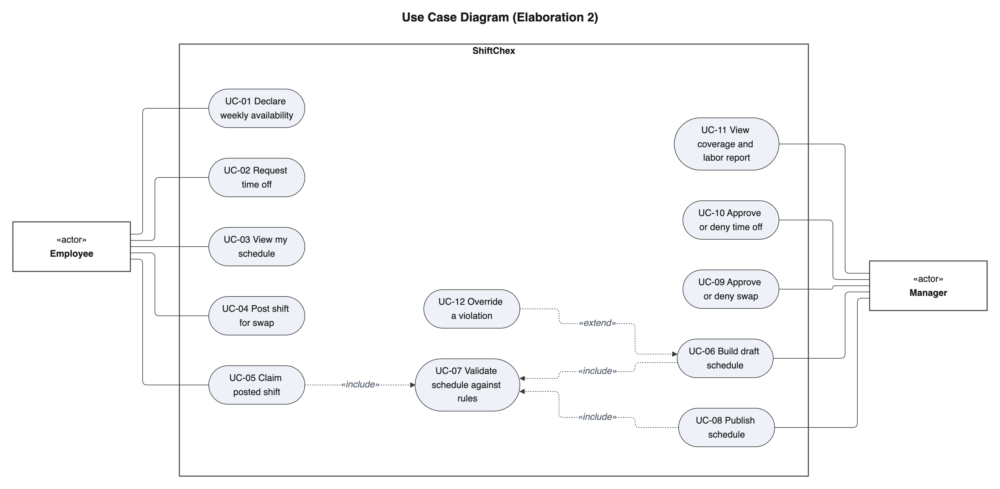
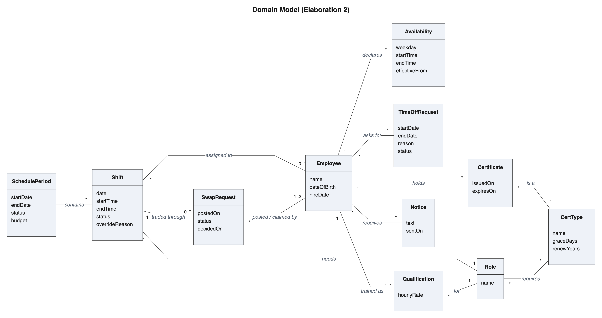
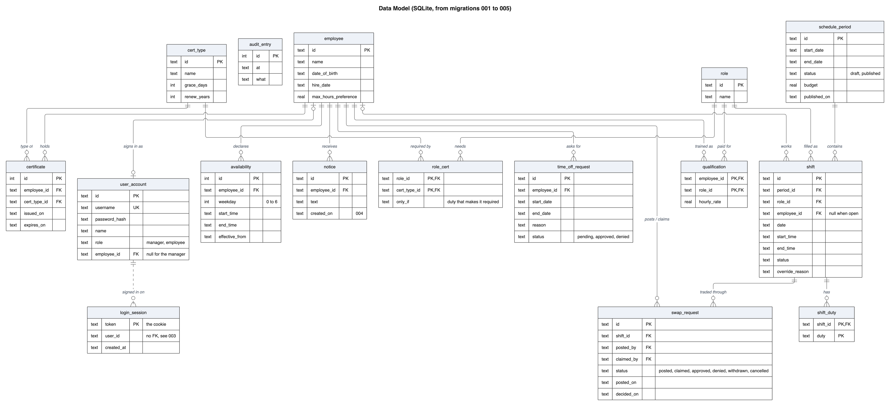
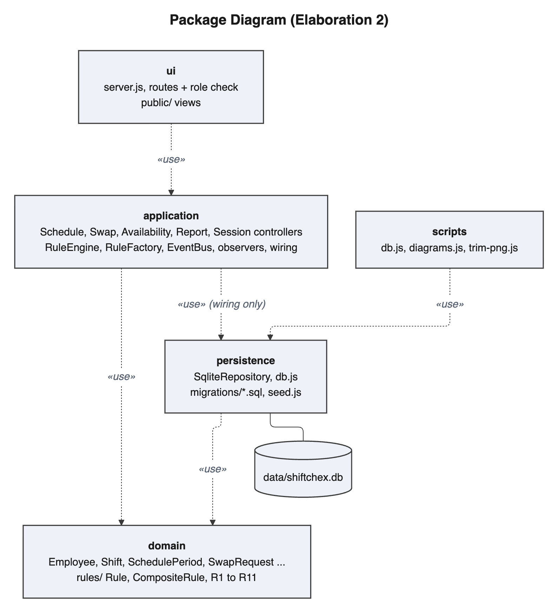
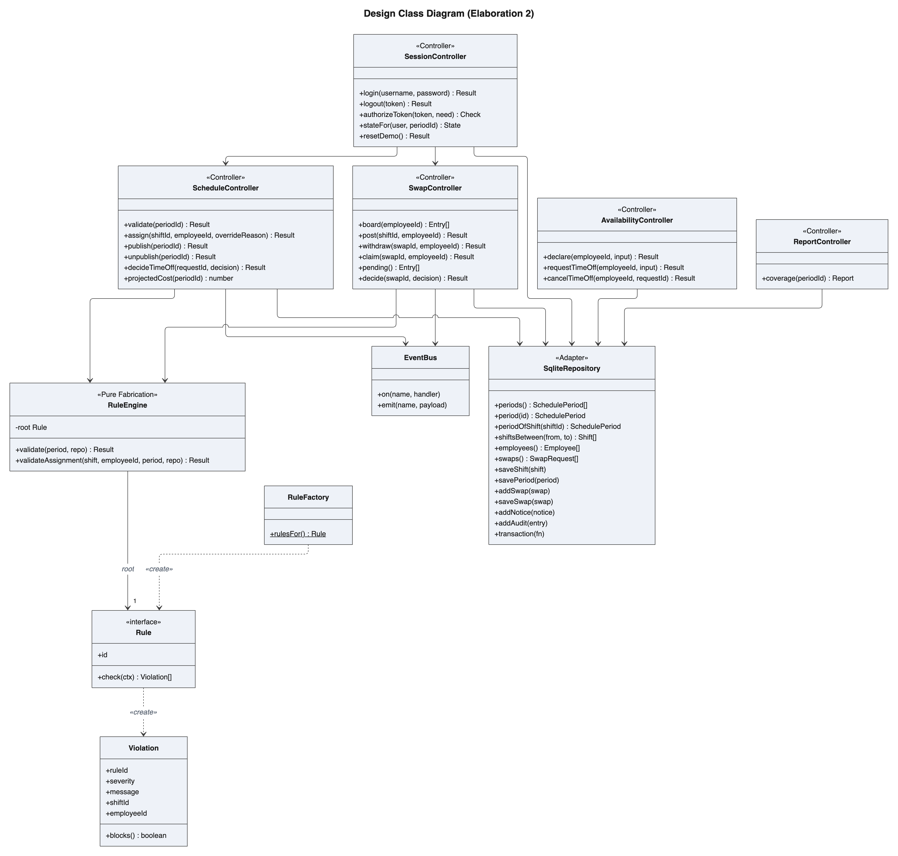
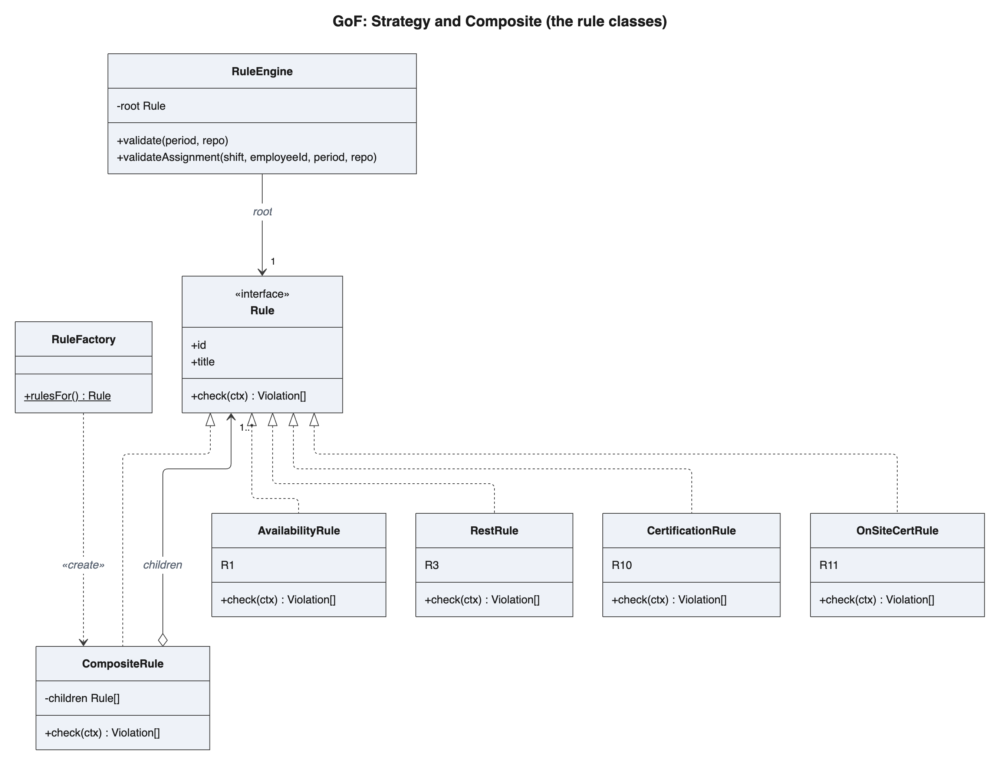
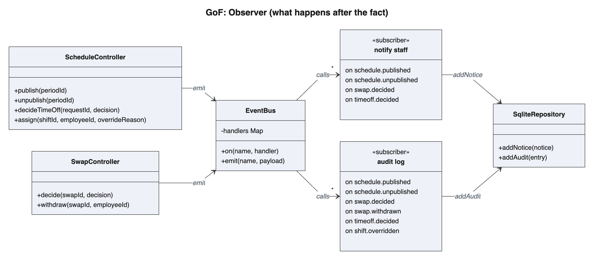

# Diagrams

The source for every diagram is a Mermaid file under `mmd/`, and the pictures
under `images/` are generated from them, in the same folders. Don't edit the
PNGs by hand.

```
mmd/ and images/
  requirements/   use case diagram and the system sequence diagrams
  models/         domain model and data model (ER)
  design/         packages, runtime architecture, design classes
  interactions/   sequence and communication diagrams
  patterns/       GoF patterns
  behavior/       activity diagrams and state machines
```

```
npm run diagrams              # render everything
npm run diagrams -- erd patterns/   # only paths that contain erd or patterns/
```

It runs mermaid-cli through `npx`, using Chrome if it's installed. Every diagram
shares the look set in `mermaid.config.json` and `mermaid.css`, so change those
instead of styling diagrams one at a time.

Layout tips if you add one:
- Busy class, flow and ER diagrams usually look cleaner with `layout: elk` in the
  front matter (straight right-angle lines). The domain model looked better with
  the default layout, so try both.
- Mermaid has no use case, activity or communication diagram, so those are
  flowcharts. Copy an existing one to keep the same conventions.

Marked **new** if it was added in Elaboration 2.

## requirements/

| Diagram | Source |
|---|---|
| Use case diagram | [usecase](mmd/requirements/usecase.mmd) |
| SSD: Declare availability (UC-01) | [ssd_availability](mmd/requirements/ssd_availability.mmd) |
| SSD: Request and decide time off (UC-02, UC-10) | [ssd_timeoff](mmd/requirements/ssd_timeoff.mmd) |
| SSD: Claim posted shift (UC-05) | [ssd_claim](mmd/requirements/ssd_claim.mmd) |
| SSD: Publish schedule (UC-08) | [ssd_publish](mmd/requirements/ssd_publish.mmd) |
| **new** SSD: Approve or deny swap (UC-09) | [ssd_approve_swap](mmd/requirements/ssd_approve_swap.mmd) |
| **new** SSD: Coverage and labor report (UC-11) | [ssd_report](mmd/requirements/ssd_report.mmd) |
| **new** SSD: Override a violation (UC-12) | [ssd_override](mmd/requirements/ssd_override.mmd) |



## models/

| Diagram | Source |
|---|---|
| Domain model, updated with CertType, Certificate and Notice | [domain](mmd/models/domain.mmd) |
| **new** Data model (ER), every table from migrations 001 to 004 | [erd](mmd/models/erd.mmd) |




## design/

| Diagram | Source |
|---|---|
| Package diagram | [packages](mmd/design/packages.mmd) |
| **new** Runtime architecture | [architecture](mmd/design/architecture.mmd) |
| Design class diagram | [classdiagram](mmd/design/classdiagram.mmd) |




## interactions/

| Diagram | Source |
|---|---|
| Sequence: Validate schedule (UC-07) | [sd_validate](mmd/interactions/sd_validate.mmd) |
| Sequence: Claim posted shift (UC-05) | [sd_claim](mmd/interactions/sd_claim.mmd) |
| **new** Sequence: Approve swap (UC-09) | [sd_approve_swap](mmd/interactions/sd_approve_swap.mmd) |
| **new** Sequence: Publish with Observer (UC-08) | [sd_publish](mmd/interactions/sd_publish.mmd) |
| **new** Sequence: Override (UC-12) | [sd_override](mmd/interactions/sd_override.mmd) |
| **new** Sequence: Coverage and labor report (UC-11) | [sd_report](mmd/interactions/sd_report.mmd) |
| **new** Communication: Claim posted shift | [comm_claim](mmd/interactions/comm_claim.mmd) |

## patterns/

| Pattern | Where | Source |
|---|---|---|
| Strategy + Composite | the rule classes | [gof_rules.mmd](mmd/patterns/gof_rules.mmd) |
| **new** Factory | the rule tree `RuleFactory` builds | [gof_rule_tree.mmd](mmd/patterns/gof_rule_tree.mmd) |
| **new** Observer | `EventBus` and `observers.js`, notices and the audit log | [gof_observer.mmd](mmd/patterns/gof_observer.mmd) |
| **new** Adapter | `SqliteRepository` | [gof_adapter.mmd](mmd/patterns/gof_adapter.mmd) |
| **new** Facade | `RuleEngine` | [gof_facade.mmd](mmd/patterns/gof_facade.mmd) |

Singleton was considered for the rule engine and turned down, so it has no diagram.




## behavior/

| Diagram | Source |
|---|---|
| Activity: Claim and approve a posted shift | [activity_claim](mmd/behavior/activity_claim.mmd) |
| **new** Activity: Startup, migrations and seeding | [activity_startup](mmd/behavior/activity_startup.mmd) |
| **new** Activity: Certification check (R10) | [activity_cert_check](mmd/behavior/activity_cert_check.mmd) |
| State machine: Shift | [state_shift](mmd/behavior/state_shift.mmd) |
| State machine: SwapRequest | [state_swap](mmd/behavior/state_swap.mmd) |
